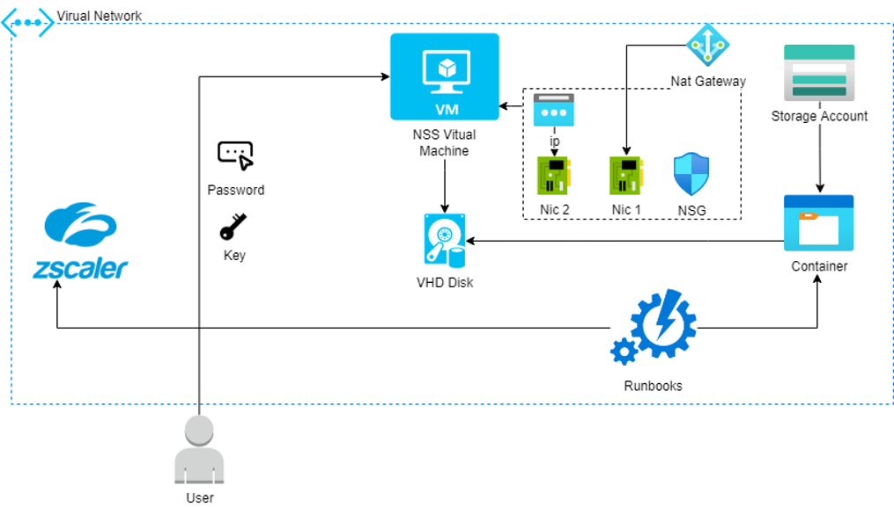

[](https://github.com/zscaler/nss-azure-deploy/releases)
[](https://github.com/zscaler/nss-azure-deploy/blob/master/LICENSE)
[](https://community.zscaler.com/)

# Zscaler NSS Azure Resource Manager (ARM) Template

[](https://portal.azure.com/#create/Microsoft.Template/uri/https%3A%2F%2Fraw.githubusercontent.com%2Fzscaler%2Fnss-azure-deploy%2Fmaster%2Fazuredeploy.json)
[](https://portal.azure.com/#create/Microsoft.Template/uri/https%3A%2F%2Fraw.githubusercontent.com%2Fzscaler%2Fnss-azure-deploy%2Fmaster%2Fazuredeploy.json)
[](http://armviz.io/#/?load=https%3A%2F%2Fraw.githubusercontent.com%2Fzscaler%2Fnss-azure-deploy%2Fmaster%2Fazuredeploy.json)

## Overview

This repository contains an Azure Resource Manager (ARM) template for deploying Zscaler Nanolog Streaming Service (NSS) in Azure cloud.  This ARM template will launch NSS, but at this time, you are required to modify the Network Service Groups (NSGs) to properly secure inbound connections based on your environment.

- 2 x VMNICs
  - `<vmName>-MGMT-NIC` - NSS Management Interface
  - `<vmName>-SRVC-NIC` - NSS Service Interface

- 1 x NAT Gateway
- 2 x Public IP Addresses
  - `<vmName>-MGMT-IP` - NSS Management Interface
  - `<vmName>-SRVC-IP` - NAT Gateway Public IP
- 1 x Public IP Prefix

- 1 x VNET (Virtual Network)
- 2 x Subnets
  - Service Subnet (with NAT Gateway)
  - Management Subnet
- 1 x Network Security Group
- 1 x Storage Account
- 1 x Automation Account
- 1 x Virtual Machine

### NSS Architecture



## Important Notes

The template uses an Azure automation account runbook to make a copy of the new NSS OS Disk, and stores it in the newly created or existing storage account.

The NSS VM carries 2 Network Interfaces. The primary interface is used for management and carries a public IP address. At this time, you are required to modify the Network Service Groups (NSGs) to properly secure inbound connections based on your environment. The second interface is used for service purposes, and is placed on a private subnet behind a NAT Gateway.

## Deployment Instructions

### Prerequisites

Before deploying, ensure you have the following:

1. **Azure Subscription**: An active Azure subscription with permissions to create resources
2. **SAS Token**: Contact [Zscaler Support](https://help.zscaler.com/login-tickets) to obtain the NSS VHD SAS Token for your selected region
3. **Resource Group**: Create or identify an existing resource group for deployment

### Deployment Methods

#### Option 1: Deploy via Azure Portal (Recommended)

1. Click the **Deploy to Azure** button at the top of this README
2. Sign in to your Azure account if prompted
3. Fill in the required parameters:
   - **Subscription**: Select your Azure subscription
   - **Resource Group**: Create new or select existing
   - **Region**: Select your deployment region
   - **VHD Region**: Select the Zscaler storage region closest to your deployment (see [VHD Image Storage](#zscaler-nss-vhd-image-storage) section)
   - **SAS Token**: Paste the SAS token obtained from Zscaler Support
   - **VM Size**: Select the appropriate VM size (default: `Standard_D2_v4`)
   - **SSH Source Address Prefix**: Restrict SSH access to your admin IP range (recommended)
4. Review the remaining parameters and adjust as needed
5. Click **Review + create**, then **Create** to start deployment

#### Option 2: Deploy via Azure CLI

> **Note** Before deploying, update `azuredeploy.parameters.json` with your desired values (VM name, VHD region, SAS token, network settings, etc.).

```bash
# Login to Azure
az login

# Create a resource group (if needed)
az group create --name <resource-group-name> --location <location>

# Deploy the template
az deployment group create \
  --resource-group <resource-group-name> \
  --template-uri https://raw.githubusercontent.com/zscaler/nss-azure-deploy/master/azuredeploy.json \
  --parameters @azuredeploy.parameters.json
```

#### Option 3: Deploy via Azure PowerShell

> **Note** Before deploying, update `azuredeploy.parameters.json` with your desired values (VM name, VHD region, SAS token, network settings, etc.).

```powershell
# Login to Azure
Connect-AzAccount

# Create a resource group (if needed)
New-AzResourceGroup -Name <resource-group-name> -Location <location>

# Deploy the template
New-AzResourceGroupDeployment `
  -ResourceGroupName <resource-group-name> `
  -TemplateUri "https://raw.githubusercontent.com/zscaler/nss-azure-deploy/master/azuredeploy.json" `
  -TemplateParameterFile "azuredeploy.parameters.json"
```

### Supported VM Sizes

The following VM sizes are supported as per [Zscaler's deployment guide](https://help.zscaler.com/zia/nss-deployment-guide-microsoft-azure):

| VM Size | vCPUs | Memory |
|---------|-------|--------|
| `Standard_D2_v4` (default) | 2 | 8 GB |
| `Standard_D4_v4` | 4 | 16 GB |
| `Standard_D8_v4` | 8 | 32 GB |
| `Standard_D16_v4` | 16 | 64 GB |

### Post-Deployment Steps

1. **Verify Deployment**: Check the Azure Portal for deployment status and review outputs
2. **Configure NSG Rules**: Modify the Network Security Group to restrict inbound SSH access to your admin IP ranges
3. **Access the VM**: SSH into the NSS VM using the management public IP address
4. **Complete NSS Configuration**: Follow [Zscaler's NSS configuration guide](https://help.zscaler.com/zia/about-nanolog-streaming-service) to complete setup

> **Note** The template takes about 20-30 minutes to deploy due to the VHD image size (~500GB+). Do not cancel the deployment once started.

## Zscaler NSS VHD Image Storage

Zscaler hosts its VHD images in multiple storage accounts across different regions. This template is configured in a way where the administrator can select which region the VHD image must be transferred from. We recommend that you select the storage closest to the region where the resource group and storage account will be located. The following options are available in the drop down menu when deploying the template via the Azure Template wizard:

### Commercial Azure Regions

| Region Code | Description |
|-------------|-------------|
| `znssprod` | US Commercial |
| `znssprodeu` | Europe |
| `znssprodau` | Australia |

### Azure Government Regions

The following options must be used specifically by Government customers:

| Region Code | Description |
|-------------|-------------|
| `zsgovnsstexas` | US Gov Texas |
| `zsgovnssarizona` | US Gov Arizona |
| `zsgovnssiowa` | US Gov Iowa |
| `zsgovnssvirginia` | US Gov Virginia |

> **Note** Choosing a government region for deployment in a commercial Azure account is not supported and will cause the template deployment to fail.

> **Note** Each region requires authentication via a dedicated SAS Token. Please contact Zscaler Support to obtain the necessary SAS token, by providing the name of the region where you want to download the VHD image from.

## Support and Reporting Issues

Support for this ARM template is made available exclusively through Github repo issue tracking.  You are also welcome to contact the contributors directly via their provided contact information.  If you find a bug, please open an issue against this repo [here](https://github.com/zscaler/nss-azure-deploy/issues).

## Contributors

Zscaler is actively contributing to and maintaining this repo.

  Contributors:
  [Eddie Parra](https://github.com/eparra), [Rohan Upalekar](https://github.com/rohan-zscaler), Anoop SV, [William Guilherme](https://github.com/willguibr), [Paul Lopez](https://github.com/prlopez)

## Licensing

This work is released under the MIT license. A copy of the license is provided in the [LICENSE](https://github.com/zscaler/nss-azure-deploy/blob/master/LICENSE) file.

## References

- [About Nanolog Streaming Service](https://help.zscaler.com/zia/about-nanolog-streaming-service)

`Tags: virtual machine, Linux, Ubuntu Server, Microsoft.Network/networkInterfaces, Microsoft.Network/networkSecurityGroups, Microsoft.Network/virtualNetworks, Microsoft.Network/virtualNetworks/subnets, Microsoft.Network/publicIPAddresses, Microsoft.Compute/virtualMachines, Microsoft.Storage/storageAccounts, Microsoft.Automation/automationAccounts`
